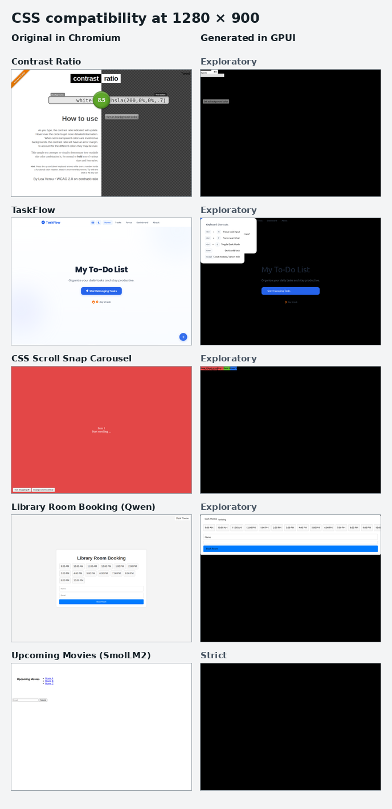

# CSS compatibility on five independent screens

**2 of 10 viewport runs converted cleanly and built as native Rust. 0 of 10 matched Chromium appearance.** The two clean runs came from the same small AI-generated cinema screen. Its text field and keyboard focus failed native replay at both sizes. All eight runs with declared source losses produced runnable exploratory output. None met the baseline appearance threshold.

The run used compiler `7ad79513bb3720aa91e0fb4fac813ad59f37d391`, Chromium `148.0.7778.96` through Playwright 1.60.0, and GPUI 0.2.2 on Linux X11 with Mesa lavapipe. The frozen corpus was `bd5925dbef26613bb934c364acee7e6145ecd4a497c50e7dda17d9d8512bbf2b`. Chromium captured all 10 baselines and all 26 recorded states without a page exception or a missing measured asset. [Protocol and source provenance](../README.md), [machine-readable results](2026-11-27.json)

## Conversion and baseline appearance

Viewport pairs below are for **390×844 / 1280×900**. Counts are individual diagnostics including repeated declarations. A zero in the target-loss column can mean either no reported target loss or a dropped behavior the target never saw. Target counts for the four lossy screens come from the exploratory pass. Normalized RGB error must be ≤0.030 and the fraction of channels over 16 of 255 must be ≤0.100 to pass.

| Screen | Clean native builds | Source losses | Target losses | Native capture tier | Normalized RGB error | Fraction of channels over 16 |
| --- | ---: | ---: | ---: | --- | ---: | ---: |
| Contrast Ratio | 0/2 | 69 / 69 | 2 / 2 | Exploratory | .595 / .605 | .966 / .985 |
| TaskFlow | 0/2 | 4892 / 4861 | 6 / 6 | Exploratory | .439 / .862 | .486 / .886 |
| CSS Scroll Snap Carousel | 0/2 | 16 / 16 | 0 / 0 | Exploratory | .487 / .484 | .990 / .997 |
| Library Room Booking (Qwen) | 0/2 | 10 / 10 | 1 / 1 | Exploratory | .665 / .687 | .715 / .726 |
| Upcoming Movies (SmolLM2) | 2/2 | 0 / 0 | 0 / 0 | Strict | .994 / .998 | .998 / .999 |

TaskFlow contributed most of the 9,943 source diagnostics across viewport runs. Font Awesome accounted for 3,473 per size, Poppins for 18 per size, and TaskFlow’s own stylesheet for 1,401 at 390×844 and 1,370 at 1280×900. All 18 target diagnostics across the exploratory runs were `TextInputControl`. The browser's user-agent canvas, link and form affordances, and default text styles differed from the direct GPUI host. A separate, unscored check gave the cinema host a white canvas and black text. The headings then painted, but pressing Tab still changed zero native pixels.

## Feature-family coverage

Each feature denominator counts tagged evaluation screens. The two viewport runs must both support the relevant comparison. A blocked screen stays in the denominator. The rows overlap. No screen passed strict appearance at both sizes, so **0 of 5 screens demonstrated matched viewport reflow**. These runs measured two separately compiled client sizes. Live native resizing remains unverified.

| Feature | Matched screens | Observed failures and blocked checks |
| --- | ---: | --- |
| Responsive layout | 0/5 | Chromium laid out TaskFlow’s stats in one versus four columns and wrapped the Qwen time slots into a 312 px versus 600 px rail. The direct pipeline rejected authored `grid-template-columns` and `flex-wrap`. The only strict native render failed at both sizes. Flex wrapping is tracked in ISS-30. [TaskFlow CSS](../corpus/taskflow/styles.css), [Qwen source](../corpus/qwen-library/index.html) |
| Typography | 0/5 | `text-align` was reported in four evaluation screens, and `letter-spacing` in Contrast Ratio and TaskFlow. Contrast Ratio also lost the `font` shorthand. The strict cinema output missed browser link and list presentation. Text alignment and letter spacing are tracked in ISS-31 and ISS-32. [Contrast Ratio CSS](../corpus/contrast-ratio/style.css), [TaskFlow CSS](../corpus/taskflow/styles.css) |
| Forms | 0/4 | Contrast Ratio, TaskFlow and Qwen emitted `TextInputControl` losses for recognized fields. The cinema email field emitted a plain `div` without a loss. Chromium inserted the email and changed 2,004 pixels at each size. The native click and typing sequence changed zero. Unsupported control diagnostics and editable text controls are tracked in ISS-28 and ISS-29. [Cinema source](../corpus/smollm-cinema/index.html), [control extraction](../../../src/extractor/mod.rs) |
| Keyboard focus | 0/4 | Chromium focused the first cinema link on Tab and changed 320 pixels at each size. Equivalent native input changed zero. Strict focus comparison for the other three screens was blocked by source loss. Contrast Ratio’s contextual focus rule and TaskFlow’s focus-visible styling exposed additional CSS state gaps. Hover and focus paint are tracked in ISS-33. [Contrast Ratio CSS](../corpus/contrast-ratio/style.css), [TaskFlow CSS](../corpus/taskflow/styles.css) |
| Scrolling | 0/1 | One 800 px horizontal wheel input settled at 780 px on the narrow Carousel and 1,280 px on desktop. Strict conversion rejected `overflow-x`, `scroll-snap-type` and `scroll-snap-align`. Native scrolling is unverified. [Carousel source](../corpus/scroll-snap/index.html) |
| Themes | 0/2 | Chromium switched TaskFlow’s theme attribute to `dark`. Qwen’s browser body background changed from `rgb(244, 244, 244)` to `rgb(51, 51, 51)` under dark preference. The direct compiler diagnosed that preference query as unevaluated. Native theme parity is unverified. [TaskFlow CSS](../corpus/taskflow/styles.css), [Qwen source](../corpus/qwen-library/index.html) |
| Motion | 0/2 | Chromium captured Contrast Ratio’s disclosure panel after hover and TaskFlow’s hovered button at `scale(1.08)`. The strict compiler rejected the contextual selector or relevant transform and transition properties. Native motion timing is unverified. [Contrast Ratio CSS](../corpus/contrast-ratio/style.css), [TaskFlow CSS](../corpus/taskflow/styles.css) |

Only four strict native gesture rows were available. All four diverged from Chromium. The remaining 22 browser states had no strict native equivalent because conversion reported source losses. The two excluded AI generation attempts are preserved as acquisition evidence and have no compiler rows. The Accessible Form Controls Pen remains a frozen, unevaluated holdout and contributes no evaluation rows. These outcomes support a claim about these five named screens and the already documented individual fixture demonstrations. A broad claim about compatibility with ordinary modern CSS remains unsupported by this run.
